# Evidências: WordPress com Nginx e Docker Compose

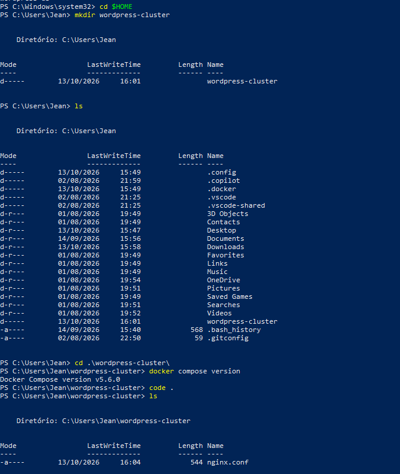

*Figura 1. Criação da pasta wordpress-cluster, verificação do Docker Compose (v5.6.0) e arquivo nginx.conf.*

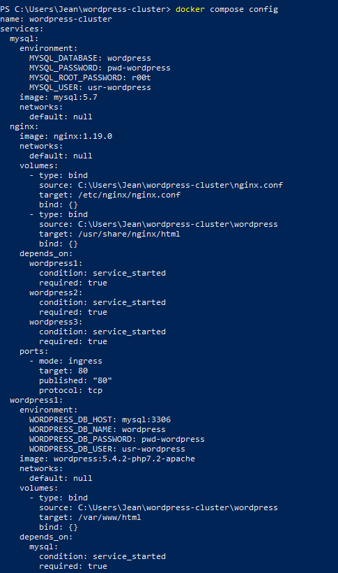

*Figura 2. docker compose config (parte 1): serviços mysql, nginx e wordpress1. Só o nginx publica a porta 80.*

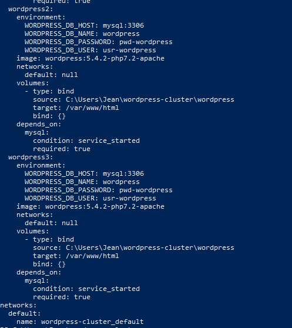

*Figura 3. docker compose config (parte 2): wordpress2 e wordpress3 com o mesmo banco e a mesma pasta compartilhada.*

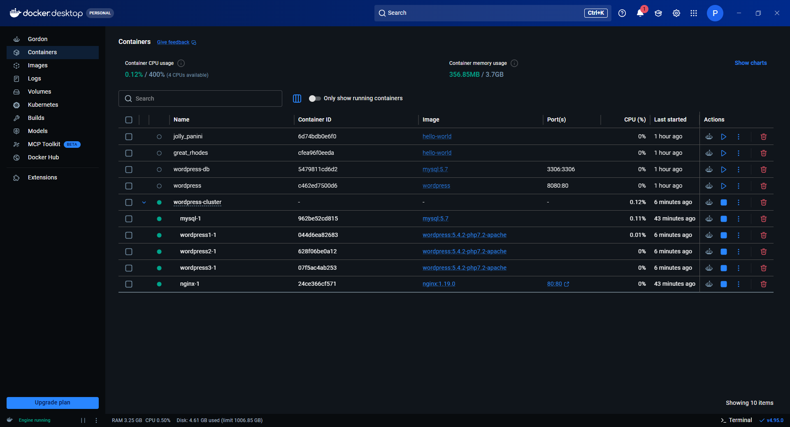

*Figura 4. Docker Desktop com o projeto wordpress-cluster: mysql, três WordPress e nginx em execução. Os contêineres em cinza são do Trabalho 1 e estão parados.*

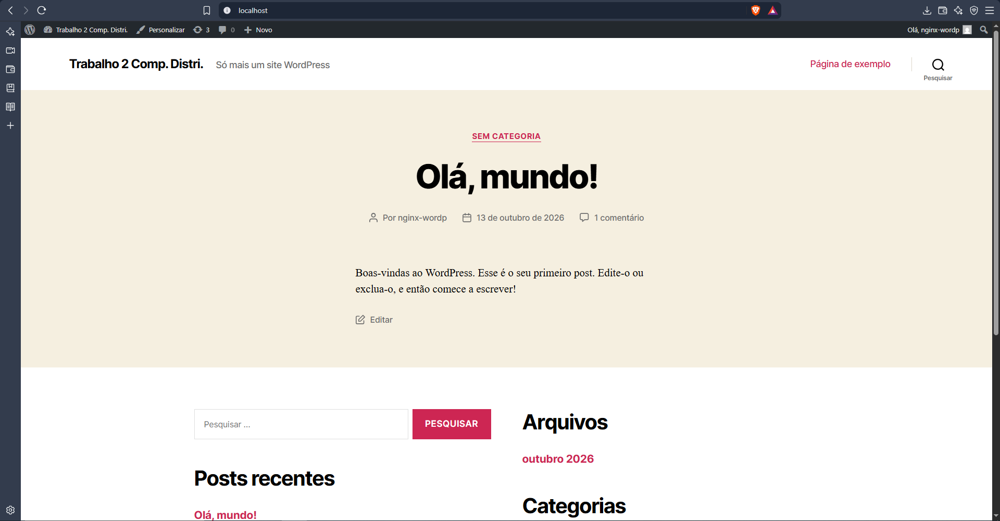

*Figura 5. Site WordPress instalado, acessado por http://localhost (via Nginx), com a barra de administração visível.*

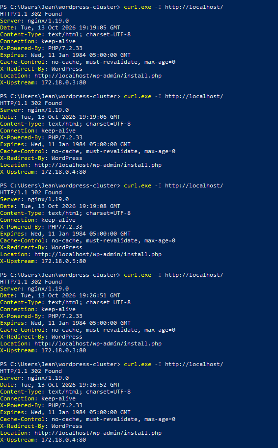

*Figura 6. curl.exe -I http://localhost/ (parte 1): o X-Upstream alterna entre 172.18.0.3, 172.18.0.4 e 172.18.0.5.*

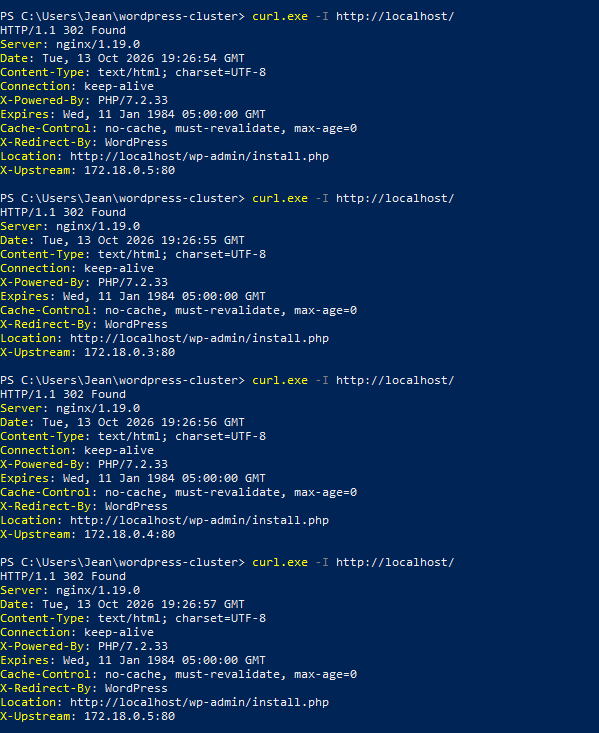

*Figura 7. curl.exe -I http://localhost/ (parte 2): a rotação continua em 172.18.0.5, .3, .4 e .5.*

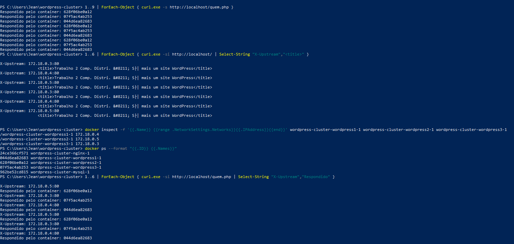

*Figura 8. Nove requisições ao quem.php (cada contêiner responde 3 vezes), título igual nas respostas da página inicial e mapeamento entre ID, nome e IP dos contêineres.*

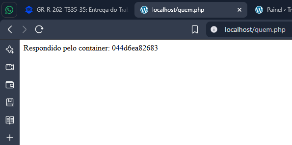

*Figura 9. quem.php no navegador, respondido pelo wordpress1 (044d6ea82683).*

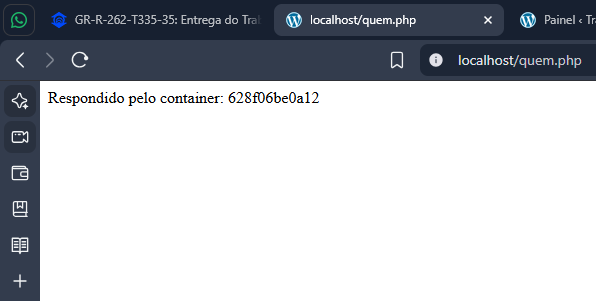

*Figura 10. quem.php no navegador, respondido pelo wordpress2 (628f06be0a12).*

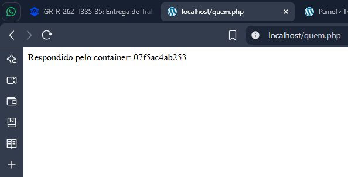

*Figura 11. quem.php no navegador, respondido pelo wordpress3 (07f5ac4ab253).*

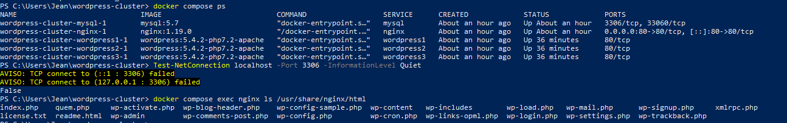

*Figura 12. docker compose ps (só o nginx publica porta), Test-NetConnection na porta 3306 (False) e ls em /usr/share/nginx/html (arquivos compartilhados, com o quem.php).*

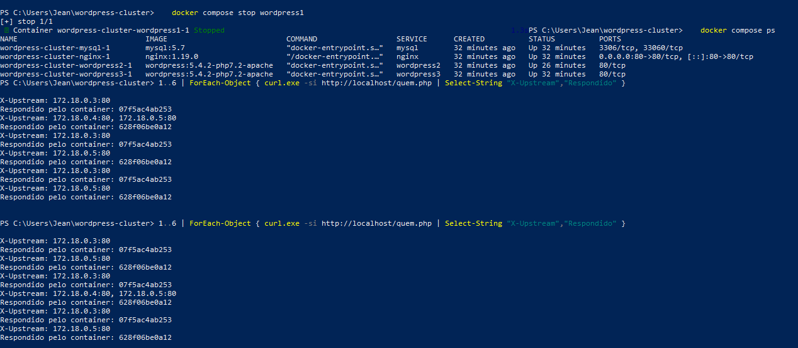

*Figura 13. Teste 1: wordpress1 parado. Apenas wordpress2 e wordpress3 respondem; uma resposta mostra dois IPs no X-Upstream (failover).*

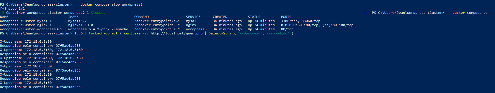

*Figura 14. Teste 2: wordpress1 e wordpress2 parados. Todas as respostas vêm do wordpress3.*

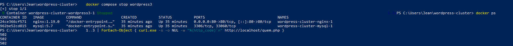

*Figura 15. Teste 3: os três WordPress parados. Restam nginx e mysql, e as três requisições retornam 502.*

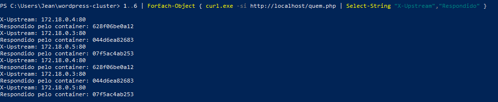

*Figura 16. Teste 4: contêineres religados e rotação restabelecida entre os três WordPress.*
